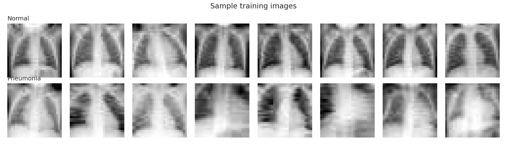
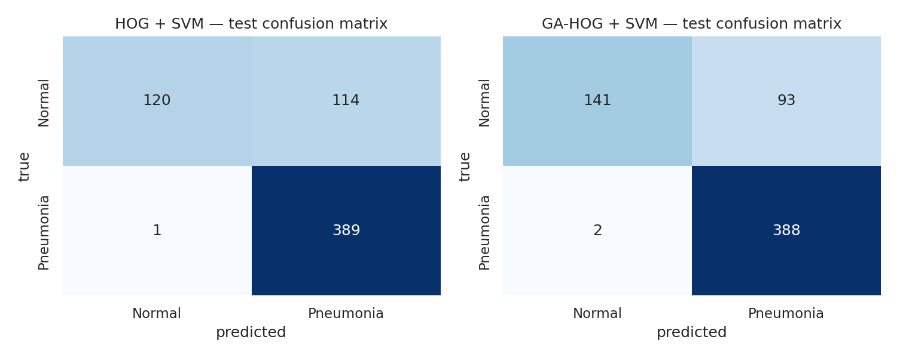
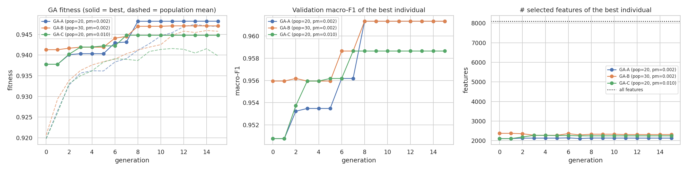
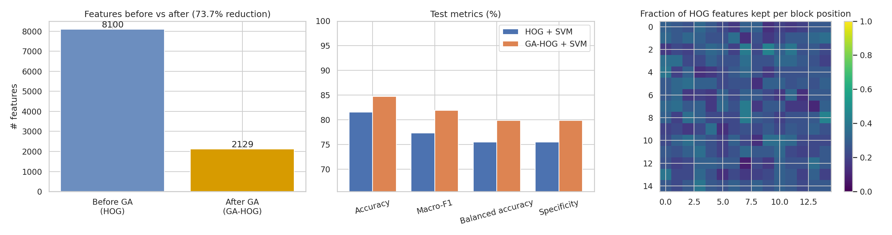

# Lab 07: Improving HOG-Based Medical Image Classification Using a Genetic Algorithm

**Student:** Muhammad Umer Rafiq (FA23-BAI-013) | **Course:** Introduction to Computer Vision | **Instructor:** Dr. Jamal Hussain Shah | **Date:** 22-Oct-2026

Figures referenced below are in the extracted `lab07_outputs/` folder (keep this file next to that folder).

## 1. Objective and Research Question

The objective of this lab is to modify the traditional Histogram of Oriented Gradients (HOG) pipeline by adding a Genetic Algorithm (GA) for feature selection, and to evaluate whether the modified pipeline (GA-HOG + SVM) improves classification performance over the standard HOG + SVM baseline on a medical image dataset.

> **Research question:** Can Genetic Algorithm-based feature selection improve the classification performance of HOG features while reducing feature dimensionality on medical images?

> **Short answer:** Yes, in this experiment. On the untouched test set the GA kept only 2,129 of 8,100 HOG features (73.7 % fewer) and raised macro-F1 from 77.36 % to 81.95 % (+4.58 percentage points; 95 % bootstrap CI +2.70 to +6.74). Two caveats matter and are discussed in Section 5: the validation set did not show this gain, and only one random seed was run.

## 2. Dataset Reference and Method

### 2.1 Dataset

- **Dataset:** PneumoniaMNIST, a binary chest X-ray task (Normal vs. Pneumonia) from the MedMNIST collection (Yang et al., MedMNIST v2, Scientific Data 10:41, 2023), derived from the pediatric chest X-ray data of Kermany et al. (Cell 172(5), 2018).
- **Source used:** Kaggle dataset `rijulshr/pneumoniamnist`, downloaded with `kagglehub.dataset_download("rijulshr/pneumoniamnist")` (file `pneumoniamnist.npz`).
- **Images:** 28 × 28 grayscale, up-sampled to 128 × 128 (bicubic) as required by the lab configuration.
- **Split (fixed, provided by the dataset and identical for both pipelines):** train 3,882 images (Normal 388, Pneumonia 3,494); validation 524 (Normal 135, Pneumonia 389); test 624 (Normal 234, Pneumonia 390). The share of Normal images is 10.0 %, 25.8 % and 37.5 % respectively, so the classes are imbalanced and the three splits are not identically distributed.

*Figure 1. Sample training images of each class (28 × 28 native resolution).*

### 2.2 Pipeline

- **Preprocessing and HOG:** resize to 128 × 128, scale to [0, 1], HOG with 9 orientations, 8 × 8 pixel cells, 2 × 2 cell blocks and L2-Hys normalisation, giving 15 × 15 blocks × 36 values = **8,100 features** per image. Extraction took 42.2 s for all 5,030 images.
- **Baseline (HOG + SVM):** RBF-kernel SVM on all 8,100 features with balanced class weights. C ∈ {0.1, 1, 10, 100} and gamma multiplier ∈ {0.5, 1, 2} (gamma = multiplier / (n_features × feature variance)) were tuned on validation macro-F1. Selected: C = 1, multiplier = 1.
- **GA-HOG + SVM:** a GA searches a binary mask over the 8,100 HOG features. Individuals are initialised as random masks with density drawn from U(0.2, 0.8), plus one all-ones individual. Fitness = validation macro-F1 − 0.05 × (selected features / 8,100). Operators: tournament selection (size 3), uniform crossover (p = 0.9), bit-flip mutation, 2 elite individuals, at least 50 features kept, 15 generations. Inside the GA the SVM is trained on a stratified 2,000-image subset of the training set for speed; the final model is trained on the full training set after re-tuning C and gamma on validation.
- **Three GA settings were compared:** GA-A (population 20, mutation 0.002), GA-B (population 30, mutation 0.002) and GA-C (population 20, mutation 0.010). The setting with the best validation fitness was selected, and only then was the test set used.
- **Implementation and hardware:** Google Colab, Tesla T4 GPU. RBF kernel matrices are computed on the GPU with PyTorch and solved with scikit-learn's `SVC(kernel="precomputed")`. Random seed 42 throughout.

### 2.3 Experimental configuration

**Table 1. Experimental configuration and HOG feature-extraction parameters**

| Parameter | Baseline: HOG + SVM | Proposed: GA-HOG + SVM |
|---|---|---|
| Medical dataset | PneumoniaMNIST | PneumoniaMNIST |
| Image resolution | 128 × 128 | 128 × 128 |
| HOG orientations | 9 | 9 |
| Pixels per cell | 8 × 8 | 8 × 8 |
| Cells per block | 2 × 2 | 2 × 2 |
| Block normalization | L2-Hys | L2-Hys |
| HOG feature dimension | 8100 | 8100 |
| Feature selection | None | Genetic Algorithm (binary feature mask) |
| Classifier | SVM | SVM |
| SVM kernel | RBF | RBF |
| Class weights | balanced | balanced |
| Hyperparameter tuning | Validation set (C, gamma) | Validation set (C, gamma) |
| Data split | Identical fixed split: 3,882 / 524 / 624 (train / val / test) | Identical fixed split: 3,882 / 524 / 624 (train / val / test) |
| Random seed | Fixed (42) | Fixed (42) |

*Additional settings that are identical for both pipelines: balanced class weights, HOG feature dimension 8,100, validation-based tuning of C and gamma.*

## 3. Experimental Results

### 3.1 Main comparison on the test set

**Table 2. Main performance comparison: without GA versus with GA (test set, 624 images)**

| Metric | HOG + SVM (Baseline) | GA-HOG + SVM (Proposed) | Improvement |
|---|---|---|---|
| Accuracy (%) | 81.57 | 84.78 | +3.21 |
| Precision (Macro, %) | 88.25 | 89.63 | +1.38 |
| Recall (Macro, %) | 75.51 | 79.87 | +4.36 |
| Macro-F1 (%) | 77.36 | 81.95 | +4.58 |
| Weighted-F1 (%) | 79.80 | 83.73 | +3.93 |
| Balanced accuracy (%) | 75.51 | 79.87 | +4.36 |
| Specificity (Macro, %) | 75.51 | 79.87 | +4.36 |
| Cohen's kappa | 0.565 | 0.648 | +0.083 |
| Matthews correlation coefficient (MCC) | 0.625 | 0.688 | +0.063 |

*Improvement = GA-HOG minus baseline (percentage points for % metrics, absolute difference for kappa and MCC). Precision, recall, F1 and specificity are macro-averaged (unweighted mean over the two classes). Specificity is computed one-vs-rest from the confusion matrix for each class and then averaged; with two classes this equals macro recall and balanced accuracy, which is why those three rows are identical.*

The GA-selected features improve every metric. The largest gains are in macro-recall / balanced accuracy / specificity (+4.36 points) and macro-F1 (+4.58 points). A paired bootstrap on the test set (2,000 resamples) gives a macro-F1 difference of +4.60 points with a 95 % interval of +2.70 to +6.74, so the gain is not explained by test-sampling noise alone.

**Table 3. Test-set confusion counts and per-class recall**

| Model | TN (Normal correct) | FP (Normal as Pneumonia) | FN (Pneumonia as Normal) | TP (Pneumonia correct) | Normal recall | Pneumonia recall |
|---|---|---|---|---|---|---|
| HOG + SVM | 120 | 114 | 1 | 389 | 51.28 % | 99.74 % |
| GA-HOG + SVM | 141 | 93 | 2 | 388 | 60.26 % | 99.49 % |

The improvement comes almost entirely from the Normal class: false positives fall from 114 to 93 (Normal recall 51.3 % to 60.3 %), while one additional pneumonia case is missed (false negatives 1 to 2). For a screening use case this trade-off should be stated explicitly.

*Figure 2. Test-set confusion matrices of the baseline (left) and GA-HOG (right).*

### 3.2 GA settings, fitness across generations and feature count

**Table 4. Comparison of the three GA settings (selection on validation only)**

| GA setting | Pop. | Mut. prob. | Best fitness | Features kept | Reduction | SVM evals | GA time (s) |
|---|---|---|---|---|---|---|---|
| GA-A (pop=20, pm=0.002) | 20 | 0.002 | 0.9482 | 2129 | 73.7 % | 290 | 13.9 |
| GA-B (pop=30, pm=0.002) | 30 | 0.002 | 0.9471 | 2312 | 71.5 % | 450 | 21.9 |
| GA-C (pop=20, pm=0.010) | 20 | 0.01 | 0.9448 | 2246 | 72.3 % | 290 | 14.2 |

*Fitness = validation macro-F1 (SVM trained on the 2,000-image subset) minus 0.05 × feature fraction. GA-A had the highest fitness and was selected. All three kept about 71 to 74 % fewer features.*

*Figure 3. GA fitness (left; solid = best, dashed = population mean), validation macro-F1 of the best individual (centre) and number of selected features (right) across generations.*

For the selected GA-A, best fitness rose from 0.9378 (initial population) to 0.9482 (plateau from about generation 8) and the population mean rose from 0.9198 to 0.9469. The larger population (GA-B) did not beat GA-A and cost 57 % more time (21.9 s vs. 13.9 s); the higher mutation rate (GA-C) converged to a lower fitness. The number of selected features of the best individual stayed between about 2,100 and 2,400 during the whole run, i.e. most of the dimensionality reduction was already present in the best randomly initialised mask and the GA mainly improved which features were kept.

*Figure 4. Features before and after selection (left), test metrics (centre) and fraction of HOG features kept per block position (right).*

### 3.3 Validation-set results (used for model selection)

**Table 5. Validation-set comparison after hyper-parameter tuning**

| Metric | HOG + SVM | GA-HOG + SVM | Difference |
|---|---|---|---|
| Accuracy (%) | 96.76 | 96.37 | -0.38 |
| Precision (Macro, %) | 96.78 | 95.57 | -1.21 |
| Recall (Macro, %) | 94.67 | 94.90 | +0.23 |
| Macro-F1 (%) | 95.66 | 95.23 | -0.44 |
| Weighted-F1 (%) | 96.72 | 96.36 | -0.36 |
| Balanced accuracy (%) | 94.67 | 94.90 | +0.23 |
| Specificity (Macro, %) | 94.67 | 94.90 | +0.23 |
| Cohen's kappa | 0.913 | 0.905 | -0.008 |
| Matthews correlation coefficient (MCC) | 0.914 | 0.905 | -0.009 |

*GA-HOG was re-tuned on the selected features (C = 1, gamma multiplier = 0.5).*

### 3.4 Computational cost

**Table 6. Computational time and model size (Tesla T4, seconds)**

| Stage (seconds unless stated) | HOG + SVM | GA-HOG + SVM |
|---|---|---|
| HOG extraction (shared, all splits) | 42.21 | 42.21 |
| GA feature selection | 0.00 | 13.86 |
| Hyper-parameter tuning (C, gamma) | 1.92 | 1.41 |
| Final SVM training (full train set) | 0.22 | 0.15 |
| Test-set inference | 0.03 | 0.01 |
| TOTAL pipeline | 44.38 | 57.65 |
| Number of features | 8,100 | 2,129 |
| Support vectors | 945 | 900 |

*HOG extraction is shared and dominates the cost. The GA stage ran 290 SVM evaluations for GA-A (50 s for all three settings together). Prediction times are tiny and therefore noisy.*

## 4. Discussion

### 4.1 Did GA-based feature selection improve performance?

On the test set, yes: all nine metrics improved, with macro-F1 +4.58 points, balanced accuracy +4.36 points and MCC +0.063, using 73.7 % fewer features (8,100 to 2,129). The answer to the research question is therefore yes for this dataset and this run, for both parts of the question (better or equal performance and lower dimensionality). The result should be read with the following caveats.

- **Validation did not predict the test gain.** After re-tuning, GA-HOG scored slightly lower than the baseline on validation (macro-F1 95.23 % vs. 95.66 %, Table 5). Both models score much higher on validation than on test (baseline 95.7 % vs. 77.4 %), which reflects the different class mixture of the splits (Normal 25.8 % in validation vs. 37.5 % in test). The test improvement may therefore partly reflect the GA mask being less sensitive to this shift (a regularisation effect) rather than a uniformly better feature set.
- **One seed.** The bootstrap interval measures test-sampling uncertainty only; it does not include the randomness of the GA. Repeating the run with several seeds would be needed to claim a robust gain.
- **Weak size pressure.** With penalty weight 0.05, removing 1,000 features changes fitness by only about 0.006, so the GA is mostly driven by macro-F1 and the final size (about 26 % of the features) is largely set by the initial population.

### 4.2 Strengths

- Smaller model: 2,129 instead of 8,100 features, slightly fewer support vectors (900 vs. 945) and a cheaper kernel evaluation at prediction time.
- The selection is tied to the real objective (validation macro-F1 with the SVM in the loop), and macro-F1 plus balanced class weights prevents the GA from favouring the majority Pneumonia class.
- The selected mask is interpretable: Figure 4 (right) shows which image regions keep more HOG features.

### 4.3 Limitations

- Wrapper selection is expensive because every fitness evaluation trains an SVM; it was affordable here only because kernels run on the GPU and fitness uses a 2,000-image subsample.
- The validation set is used both inside the GA and for model selection, so the mask can overfit it; the test set was kept untouched until the end for this reason.
- Images are natively 28 × 28 and were up-sampled, so HOG is computed on interpolated gradients; HOG + SVM is a hand-crafted baseline and not a state-of-the-art classifier for this task.
- Results depend on the GA settings (population, mutation, penalty, generations); only three settings and 15 generations were explored.

### 4.4 Computational cost

The proposed pipeline costs more to build but is slightly cheaper to apply. The total pipeline time rose from 44.38 s to 57.65 s (+30 %), because the GA added 13.86 s (290 SVM evaluations) on top of the shared 42.21 s HOG extraction; all three GA settings together took about 50 s. Final SVM training (0.22 s to 0.15 s) and test inference (0.03 s to 0.01 s) were faster with the reduced feature set, although these differences are very small in absolute terms. The GA cost grows linearly with population size × generations (GA-B with 30 individuals needed 450 evaluations versus 290) and would be much higher without GPU-computed kernels or on a larger dataset.

## 5. Conclusion

GA-based feature selection reduced the HOG feature vector from 8,100 to 2,129 dimensions and improved test macro-F1 from 77.36 % to 81.95 % on PneumoniaMNIST, mainly by reducing false alarms on Normal chest X-rays at the price of one extra missed pneumonia case and about 30 % more total pipeline time. Because validation performance did not show the same gain and only one seed was run, the improvement should be confirmed with repeated runs before being treated as general.

## 6. Submission Files

- Source code: `Lab07.ipynb` (executed notebook with all outputs).
- Dataset reference: Kaggle `rijulshr/pneumoniamnist` (PneumoniaMNIST, MedMNIST).
- Results and plots: `lab07_outputs.zip` (tables 1-3 as CSV, GA settings table, GA history, selected feature mask, and the PNG figures used in this report).
